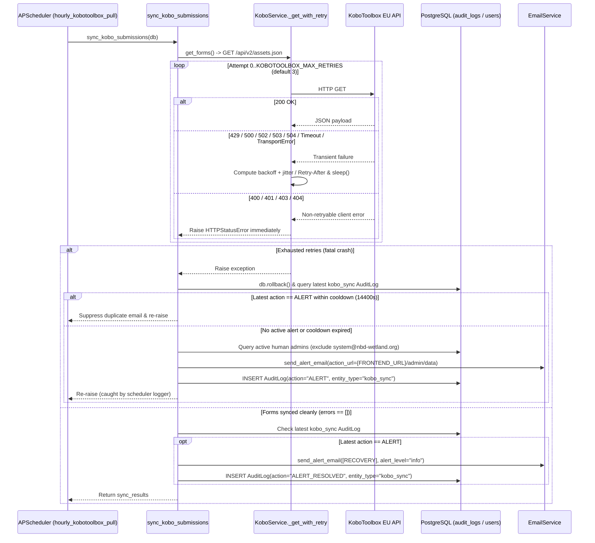

# 009 — KoboToolbox Sync Resilience, Exponential Backoff & Alert Hardening

**Author**: Mary (Analyst) & Winston (Architect)
**Date**: 2026-11-17
**Issue**: [#172](https://github.com/akvo/nbd-phase-1/issues/172)
**Incident Reference**: `[CRITICAL ALERT] Kobo Sync Service Crash` (`2026-11-05 00:02:57 UTC`, pod `worker-deployment-64dd9d59d7-bhprd`)
**Scope**: Backend Kobo Sync Service (`backend/app/services/kobo.py`), Email Service (`backend/app/mail.py`), User Model (`backend/app/models/user.py`), Environment & Docker Configuration (`.env.example`, `docker-compose.yml`), Tests (`backend/tests/test_kobo.py`, `backend/tests/test_kobo_sync.py`, `backend/tests/test_monitoring.py`)
**Status**: `IMPLEMENTED`
**Estimate**: 380m (6.3h)

---

## 1. Overview & Incident Root-Cause Analysis

### Overview
This specification adds HTTP retry with exponential backoff to `KoboService`, throttles crash notifications with `AuditLog` cooldown and recovery tracking, filters the synthetic system account from alert email recipients, and resolves email portal links from `FRONTEND_URL`. These changes protect the hourly KoboToolbox ingestion pipeline in `backend/app/scheduler.py` (`hourly_kobotoolbox_pull`) against transient upstream outages while keeping admin alert emails accurate and actionable.

### Production Incident Summary
On `2026-11-05 00:02:57 UTC`, the production worker pod (`worker-deployment-64dd9d59d7-bhprd`) failed during `sync_kobo_submissions()` (`backend/app/services/kobo.py:181`) with an unhandled exception:

```text
File "/app/app/services/kobo.py", line 193, in _sync_kobo_submissions_core
  forms = service.get_forms()
File "/app/app/services/kobo.py", line 36, in get_forms
  response.raise_for_status()
httpx.HTTPStatusError: Server error '503 Service Temporarily Unavailable' for url 'https://eu.kobotoolbox.org/api/v2/assets.json'
```

### Root Causes Identified
1. **Zero HTTP Retry or Backoff**: `KoboService.get_forms()` (`backend/app/services/kobo.py:32-38`), `KoboService.get_submissions()` (`backend/app/services/kobo.py:40-56`), and attachment downloads (`backend/app/services/kobo.py:547-552`) execute single-attempt `httpx` requests. A transient `503` from `https://eu.kobotoolbox.org` aborts the entire hourly sync immediately, leaving submissions un-ingested for 60 minutes. This misses the reliability target in `docs/prd/kobotoolbox_integration_prd.md` Section 6 ("Exponential backoff up to 3 retries").
2. **Unthrottled Crash Alerts and No Recovery Signal**: `_send_sync_crash_alert()` (`backend/app/services/kobo.py:682-726`) sends a `[CRITICAL ALERT]` email on every unhandled exception without checking `AuditLog` cooldown state or sending a recovery email when sync succeeds again. It also skips calling `db.rollback()` before querying `users`, risking a failed transaction state if a database error caused the crash.
3. **Hardcoded `localhost` Action URL in Production Emails**: `EmailService.send_alert_email()` (`backend/app/mail.py:102`) defaults `action_url` to `"http://localhost:3000/admin/data"` and `send_invite_email()` (`backend/app/mail.py:149`) defaults `login_url` to `"http://localhost:3000/login"`. The production crash alert rendered a broken `http://localhost:3000/admin/data` button instead of reading `FRONTEND_URL` as `backend/app/routers/user_router.py:139` does. Neither `.env.example` nor `docker-compose.yml` defines `FRONTEND_URL`.
4. **System Dummy User in Alert Recipients**: `User.get_or_create_system_user()` (`backend/app/models/user.py:37-49`) creates `system@nbd-wetland.org` with `role="Admin"` and `is_active=True` as a foreign-key actor for automated `AuditLog` entries. Both admin queries in `backend/app/services/kobo.py` (`lines 629-636` for DLQ warnings and `lines 688-693` for crash alerts) include `system@nbd-wetland.org` in the email `To:` list.

---

## 2. 5W1H Discovery

| Dimension | Detail |
| :--- | :--- |
| **Who** | Akvo Operations Team, NBD Platform Administrators, and the background ingestion worker (`worker` service in `docker-compose.yml`). |
| **What** | Add configurable exponential backoff retries (`KoboService._get_with_retry`), `AuditLog`-backed crash alert cooldown and recovery notifications, human-only admin recipient filtering, and `FRONTEND_URL`-based email links. |
| **Where** | `backend/app/services/kobo.py`, `backend/app/mail.py`, `backend/app/models/user.py`, `.env.example`, `docker-compose.yml`, and `backend/tests/test_*.py`. |
| **When** | Runs during every scheduled `hourly_kobotoolbox_pull()` (`backend/app/scheduler.py:226`) and manual `backend/app/scripts/sync_kobo.py` execution. |
| **Why** | Eliminates single-glitch sync failures on KoboToolbox EU `503`/`502`/`504`/`429` spikes, stops repetitive outage alert spam, removes dead `system@nbd-wetland.org` email addresses, and fixes broken `localhost` CTA links in production alerts. |
| **How** | Wrap Kobo HTTP GET requests in `_get_with_retry()` using `httpx.Client` + `time.sleep` + jitter + `Retry-After` parsing; persist `ALERT` and `ALERT_RESOLVED` rows in `audit_logs` under `entity_type="kobo_sync"`; resolve URLs from `FRONTEND_URL` at call time. |

---

## 3. Acceptance Criteria

### User Acceptance Criteria (UAC)
- **UAC-1 (Transient Retry)**: `KoboService.get_forms()`, `KoboService.get_submissions()`, and submission media attachment downloads retry transient network errors, timeouts, and retryable HTTP status codes (`429`, `500`, `502`, `503`, `504`) up to `KOBOTOOLBOX_MAX_RETRIES` times with exponential backoff before failing. Non-retryable client errors (`400`, `401`, `403`, `404`) fail immediately.
- **UAC-2 (Crash Alert Cooldown & Recovery)**: When all retry attempts fail on `get_forms()` or fatal sync setup, `_send_sync_crash_alert()` sends a `[CRITICAL ALERT]` email at most once per `KOBO_CRASH_ALERT_COOLDOWN_SECONDS` window during an ongoing outage, and the worker process continues running its hourly schedule. When the next sync completes cleanly after an active `ALERT`, the system sends a `[RECOVERY]` notice.
- **UAC-3 (Dynamic Admin CTA)**: `EmailService.send_alert_email()` and `EmailService.send_invite_email()` build default `action_url` (`{FRONTEND_URL}/admin/data`) and `login_url` (`{FRONTEND_URL}/login`) from the `FRONTEND_URL` environment variable, falling back to `http://localhost:3000`.
- **UAC-4 (Human-Only Alert Recipients)**: Both DLQ warning emails (`_sync_kobo_submissions_core`) and crash/recovery alert emails exclude `system@nbd-wetland.org` and skip email dispatch gracefully when no human active admins exist.
- **UAC-5 (Environment Parity)**: `.env.example` and `docker-compose.yml` (`backend` and `worker` services) expose `FRONTEND_URL` (with `KOBOTOOLBOX_API_TIMEOUT` passed through), while retry count (`3`), base backoff (`2.0s`), and crash alert cooldown (`14400s`) default cleanly inside `kobo.py` without requiring `.env` entries.

### Technical Acceptance Criteria (TAC)
- **TAC-1 (Retry Loop & Parameters)**: `KoboService._get_with_retry(url: str, params: dict | None = None) -> httpx.Response` retries `httpx.TimeoutException`, `httpx.TransportError`, and `httpx.HTTPStatusError` where `response.status_code in {429, 500, 502, 503, 504}`. Default configuration uses `KOBOTOOLBOX_MAX_RETRIES=3` (4 total attempts) and `KOBOTOOLBOX_RETRY_BACKOFF_SECONDS=2.0`. Delay follows `min(60.0, base * (2 ** attempt)) + random.uniform(0, 0.5 * base_delay)` and honors numeric or HTTP-date `Retry-After` headers capped at `60.0` seconds.
- **TAC-2 (Call-Site Uniformity & Mock Compatibility)**: `get_forms()`, `get_submissions()`, and attachment download (`kobo.py:547`) call `_get_with_retry()`. When `params is None`, `_get_with_retry()` omits the `params` keyword argument on `client.get(url, headers=self.headers)` so existing assertions in `backend/tests/test_kobo.py:33,191` remain green. Update `backend/tests/test_kobo_sync.py:466,605` to mock the unified client method.
- **TAC-3 (Crash Alert Cooldown via `AuditLog`)**: `_send_sync_crash_alert(db, error)` calls `db.rollback()` before querying, reads the latest `AuditLog` where `entity_type == "kobo_sync"` and `action.in_(["ALERT", "ALERT_RESOLVED"])` ordered by `timestamp DESC`, suppresses email if the latest row is `"ALERT"` and `(now - row.timestamp).total_seconds() < cooldown_seconds` (default `14400`, avoiding 60-minute scheduler boundary jitter), and otherwise sends the email and appends `AuditLog(action="ALERT", entity_type="kobo_sync", entity_id="ALERT_SENT", actor_id=sys_user.id)`.
- **TAC-4 (Recovery Signal via `AuditLog`)**: At the end of `_sync_kobo_submissions_core(db)` when `get_forms()` succeeded and `len(sync_results["errors"]) == 0`, if the latest `kobo_sync` `AuditLog` row has `action == "ALERT"`, dispatch a `[RECOVERY]` email (`alert_level="info"`) to human admins and insert `AuditLog(action="ALERT_RESOLVED", entity_type="kobo_sync", entity_id="RESOLVED", actor_id=sys_user.id)`.
- **TAC-5 (Shared Recipient Filter Helper)**: Define `SYSTEM_USER_EMAIL = "system@nbd-wetland.org"` in `backend/app/models/user.py` and reuse it inside a shared `_get_human_admin_emails(db: Session) -> List[str]` helper in `backend/app/services/kobo.py` filtering `func.lower(User.role) == "admin"`, `User.is_active.is_(True)`, and `func.lower(User.email) != SYSTEM_USER_EMAIL.lower()`.
- **TAC-6 (Call-Time URL Resolution & Secret Safety)**: Change `EmailService.send_alert_email(..., action_url: str | None = None)` and `send_invite_email(..., login_url: str | None = None)` in `backend/app/mail.py` to resolve `None` at call time via `os.getenv("FRONTEND_URL", "http://localhost:3000").rstrip("/")`. Keep `self.headers["Authorization"]` excluded from logs and exception messages.

---

## 4. Architecture Overview

1. **Scheduler Invocation**: `hourly_kobotoolbox_pull()` (`backend/app/scheduler.py:226`) calls `sync_kobo_submissions(db)`.
2. **Retried Kobo API Calls**: `KoboService.get_forms()`, `KoboService.get_submissions()`, and `KoboService.download_attachment()` delegate HTTP GET calls to `KoboService._get_with_retry()`. Transient `429`/`5xx` responses or network errors trigger bounded exponential backoff with jitter and optional `Retry-After` delay.
3. **Quarantine vs. Fatal Crash**: Per-submission mapping or attachment download exhaustion continues routing to `DeadLetter` (`db.begin_nested()`). Unrecoverable form-list failures raise out of `_sync_kobo_submissions_core()` into `sync_kobo_submissions()`.
4. **Cooldown-Gated Alerting & Recovery**: `_send_sync_crash_alert()` rolls back dirty transaction state, checks `audit_logs` (`entity_type="kobo_sync"`) against the 4-hour cooldown, and dispatches alerts only to human admins with a `FRONTEND_URL`-derived CTA link. Successful subsequent syncs resolve open `ALERT` states with `ALERT_RESOLVED` and send a recovery email.



---

## 5. Backend Implementation Specification

### 5.1 Database Model & Schema
**No database migration required.**
- `backend/app/models/audit_log.py`: Reuse existing `AuditLog` (`entity_type="kobo_sync"`, `entity_id="ALERT_SENT"` or `"RESOLVED"`). Note that `audit_logs_immutable_trigger` blocks `UPDATE` and `DELETE` on `audit_logs`, so state transitions use append-only `INSERT` rows.
- `backend/app/schemas/audit_log.py`: `AuditAction` already includes `"ALERT"` (`line 13`) and `"ALERT_RESOLVED"` (`line 19`).
- `backend/app/models/user.py`: Define module constant `SYSTEM_USER_EMAIL = "system@nbd-wetland.org"` and reference it in `User.get_or_create_system_user(cls, db)`.

### 5.2 Kobo Service (`backend/app/services/kobo.py`)
1. **Configuration & Constants**:
   - `RETRYABLE_STATUS_CODES = {429, 500, 502, 503, 504}`
   - `MAX_BACKOFF_SECONDS = 60.0`
   - `DEFAULT_TIMEOUT_SECONDS = 60.0`, `DEFAULT_MAX_RETRIES = 3`, `DEFAULT_RETRY_BACKOFF_SECONDS = 2.0`, `DEFAULT_CRASH_ALERT_COOLDOWN_SECONDS = 14400`
   - Safe `_env_int()` / `_env_float()` helpers fall back to module defaults when env vars are unset, empty, or invalid (`ValueError` / non-finite).
   - Read in `KoboService.__init__()`:
     - `self.max_retries = max(0, _env_int("KOBOTOOLBOX_MAX_RETRIES", DEFAULT_MAX_RETRIES))`
     - `self.retry_backoff = max(0.0, _env_float("KOBOTOOLBOX_RETRY_BACKOFF_SECONDS", DEFAULT_RETRY_BACKOFF_SECONDS))`
2. **Unified Retry Helper (`KoboService._get_with_retry`)**:
   - Accept `(self, url: str, params: dict | None = None) -> httpx.Response`.
   - Call `client.get(url, headers=self.headers)` when `params is None`, or `client.get(url, headers=self.headers, params=params)` when `params is not None`.
   - Call `response.raise_for_status()`.
   - On `httpx.HTTPStatusError`: re-raise immediately if `exc.response.status_code not in RETRYABLE_STATUS_CODES` or `attempt >= self.max_retries`.
   - On `(httpx.TimeoutException, httpx.TransportError)`: re-raise immediately if `attempt >= self.max_retries`.
   - Parse `Retry-After` response header when present (numeric seconds or HTTP-date via `email.utils.parsedate_to_datetime`), clamped to `[0.0, MAX_BACKOFF_SECONDS]`. Otherwise compute `base_delay = min(MAX_BACKOFF_SECONDS, self.retry_backoff * (2 ** attempt))` and add `random.uniform(0, 0.5 * base_delay)` jitter.
   - Log a warning with URL, attempt number, and delay before `time.sleep(delay)`. Never log `self.headers`.
3. **Call-Site Migration**:
   - `get_forms()`: Call `self._get_with_retry(url)`.
   - `get_submissions()`: Call `self._get_with_retry(url, params=params)`.
   - `download_attachment(download_url: str) -> bytes`: Call `self._get_with_retry(download_url).content` and replace the bare `httpx.get(...)` at `backend/app/services/kobo.py:547-552`.
4. **Recipient Filtering & Dispatch Helper**:
   - Add `_get_human_admin_emails(db: Session) -> List[str]` querying `User.email` with `func.lower(User.role) == "admin"`, `User.is_active.is_(True)`, and `func.lower(User.email) != SYSTEM_USER_EMAIL.lower()`.
   - Add `_dispatch_email_coro(coro)` helper to avoid duplicating the `asyncio` event-loop dispatch boilerplate in lines `640-672` and `702-724`.
5. **Cooldown & Recovery Tracking**:
   - `_send_sync_crash_alert(db: Session, error: Exception)`:
     - Run `db.rollback()` inside a `try/except` before any queries.
     - Query latest `AuditLog` with `entity_type="kobo_sync"` and `action.in_(["ALERT", "ALERT_RESOLVED"])` ordered by `AuditLog.timestamp.desc()`.
     - Read `cooldown = int(os.getenv("KOBO_CRASH_ALERT_COOLDOWN_SECONDS", "14400"))`.
     - If latest row is `"ALERT"` and `(datetime.utcnow() - latest.timestamp).total_seconds() < cooldown`, log cooldown suppression and return without sending email.
     - Fetch `admin_emails = _get_human_admin_emails(db)`. If empty, return.
     - Send `[CRITICAL ALERT]` via `EmailService().send_alert_email(...)` and append `AuditLog(actor_id=sys_user.id, action="ALERT", entity_type="kobo_sync", entity_id="ALERT_SENT", timestamp=now)` + `db.commit()`.
   - `_maybe_send_sync_recovery_alert(db: Session)`:
     - Call at the end of `_sync_kobo_submissions_core()` only when `len(sync_results["errors"]) == 0`.
     - Query latest `kobo_sync` `AuditLog`; if `action == "ALERT"`, send `[RECOVERY] KoboToolbox Sync Service Restored` (`alert_level="info"`) to `_get_human_admin_emails(db)` and append `AuditLog(..., action="ALERT_RESOLVED", entity_type="kobo_sync", entity_id="RESOLVED", timestamp=now)`.

### 5.3 Email Service (`backend/app/mail.py`)
- Add helper `_resolve_frontend_url() -> str`: returns `os.getenv("FRONTEND_URL", "http://localhost:3000").rstrip("/")`.
- In `EmailService.send_alert_email()`: change default `action_url: str = None` and resolve `action_url = action_url or f"{_resolve_frontend_url()}/admin/data"`.
- In `EmailService.send_invite_email()`: change default `login_url: str = None` and resolve `login_url = login_url or f"{_resolve_frontend_url()}/login"`.

### 5.4 Environment, Docker & Kubernetes Deployment Notes
- **`.env.example`** and **`docker-compose.yml`** (`backend` and `worker` services):
  - `FRONTEND_URL=http://localhost:3000` (in `docker-compose.yml`: `${FRONTEND_URL:-http://localhost:3000}`)
  - `KOBOTOOLBOX_API_TIMEOUT=60.0` (in `docker-compose.yml`: `${KOBOTOOLBOX_API_TIMEOUT:-60.0}`)
  - Retry/cooldown policy parameters (`KOBOTOOLBOX_MAX_RETRIES=3`, `KOBOTOOLBOX_RETRY_BACKOFF_SECONDS=2.0`, `KOBO_CRASH_ALERT_COOLDOWN_SECONDS=14400`) remain internal module defaults in `kobo.py` (supporting optional env override without `.env.example` / `docker-compose.yml` boilerplate).
- **Kubernetes Manifest (`backend-deployment` and `worker-deployment`)**:
  - Add `FRONTEND_URL` to both `backend-deployment` and `worker-deployment` manifests (set to the cluster's public portal origin, e.g., test vs. production URL, without trailing slash).
  - Setting `FRONTEND_URL` on `worker-deployment` is required so Kobo sync and webhook watchdog alerts render live `/admin/data` links.
- **Keyring / Secrets**:
  - No new keyring or secret entries required. `FRONTEND_URL` is a public origin URL, and retry/cooldown defaults live in `kobo.py`.

---

## 6. Phase 1 Technical Audit & Architecture Decisions

### Technical Audit Findings
- **HTTP Client (`httpx==0.27.0` in `backend/requirements.txt`)**: `httpx.HTTPTransport(retries=N)` only retries low-level `ConnectError` and `ConnectTimeout` on connection establishment. It does not retry `ReadTimeout`, `RemoteProtocolError`, or HTTP status codes (`429`, `500`, `502`, `503`, `504`), and provides no exponential backoff, jitter, or `Retry-After` support.
- **Scheduler (`APScheduler==3.10.4` in `backend/requirements.txt`)**: `hourly_kobotoolbox_pull()` (`backend/app/scheduler.py:226-244`) catches exceptions from `sync_kobo_submissions(db)`, logs them, and closes `db` in `finally`. Default `KOBO_SYNC_INTERVAL_MINUTES` is `60`. Because consecutive hourly runs can execute slightly under 3600 seconds apart (scheduler drift/jitter), a 4-hour (`14400s`) cooldown avoids false boundary re-alerts while still alerting again if an outage spans multiple hours.
- **Audit Log Immutability (`backend/app/models/audit_log.py:27-42`)**: PostgreSQL trigger `audit_logs_immutable_trigger` raises an exception on any `UPDATE` or `DELETE` on `audit_logs`. Tracking alert state via append-only `ALERT` and `ALERT_RESOLVED` inserts matches `monitor_webhook_endpoints()` in `backend/app/scheduler.py:88-220`.
- **Existing Test Impacts**:
  - `backend/tests/test_kobo.py:33,191` asserts exact `mock_client.get.assert_called_once_with(url, headers=...)` (no `params` kwarg for `get_forms()`) and `httpx.Client.assert_called_with(timeout=15.5)`. Keeping `params` omitted when `None` preserves both tests untouched.
  - `backend/tests/test_kobo_sync.py:466,605` patches `app.services.kobo.httpx.get` for media attachment downloads. Migrating attachment downloads to `KoboService.download_attachment()` (which uses `httpx.Client` via `_get_with_retry`) requires updating those two test patches.

### ADR-001: Application-Level Backoff Loop in `KoboService` vs. `tenacity`
- **Status**: Proposed
- **Context**: `KoboService` requires configurable retry with exponential backoff, jitter, `Retry-After` header parsing, and status-code selectivity (`429`/`5xx` only, fail-fast on `4xx`) under `httpx==0.27.0`.
- **Decision**: Implement `_get_with_retry()` inside `KoboService` using Python standard library primitives (`time.sleep`, `random.uniform`, `email.utils.parsedate_to_datetime`).
- **Alternatives Considered**: Adding `tenacity` to `backend/requirements.txt`. Rejected because it introduces a new external dependency requiring Docker image rebuilds across `backend`, `worker`, and CI for a single HTTP service client, and offers less direct control over `Retry-After` HTTP-date parsing alongside `httpx.Client` context mocking.
- **Consequences**: Zero new package dependencies and self-contained test mocking (`monkeypatch.setattr(time, "sleep", ...)`). If additional external HTTP clients later require complex retry policies, `_get_with_retry` can be extracted into a shared utility module.

---

## 7. Verification & Testing

### 7.1 Automated Tests (Run Inside Docker)
```bash
# Run targeted Kobo and monitoring suites
./dc.sh exec backend python -m pytest tests/test_kobo.py tests/test_kobo_sync.py tests/test_monitoring.py -v

# Run full backend test suite and linter
./dc.sh exec backend tests
./dc.sh exec backend flake8
```

### 7.2 Test Cases to Add / Update
1. **`backend/tests/test_kobo.py`**:
   - Retry succeeds after transient `503` (and `502`/`504`/`429`) responses within `KOBOTOOLBOX_MAX_RETRIES`, mocking `time.sleep`.
   - Retry succeeds after transient `httpx.TimeoutException` / `httpx.TransportError`.
   - Exhausted retries re-raise `httpx.HTTPStatusError` after `1 + max_retries` total attempts.
   - Non-retryable `401` / `404` responses fail on attempt 1 without sleeping or retrying.
   - `Retry-After` header (numeric and HTTP-date) overrides base backoff (capped at `60.0s`).
2. **`backend/tests/test_kobo_sync.py`**:
   - Update attachment download mocks at lines `466` and `605` to match `KoboService._get_with_retry` / `download_attachment`.
   - Verify attachment download retries on transient `503` before succeeding, and routes to `DeadLetter` after retry exhaustion.
3. **`backend/tests/test_monitoring.py`**:
   - Verify `system@nbd-wetland.org` is excluded from crash alert and DLQ alert recipient lists even when `is_active=True` and `role="Admin"`.
   - Verify crash alert cooldown suppresses duplicate `[CRITICAL ALERT]` emails within `KOBO_CRASH_ALERT_COOLDOWN_SECONDS` and logs `AuditLog(action="ALERT", entity_type="kobo_sync")`.
   - Verify clean sync after an active `ALERT` sends `[RECOVERY]` email and appends `AuditLog(action="ALERT_RESOLVED", entity_type="kobo_sync")`.
   - Verify `EmailService.send_alert_email()` and `send_invite_email()` render `FRONTEND_URL` when set and fall back to `http://localhost:3000` when unset.

### 7.3 Manual Verification
1. Temporarily point `KOBOTOOLBOX_API_URL` or mock a `503` endpoint and run `./dc.sh exec backend python -m app.scripts.sync_kobo` to inspect retry logs and Mailpit (`http://localhost:8025`) alert email.
2. Confirm Mailpit alert email `To:` excludes `system@nbd-wetland.org` and the CTA button href matches `FRONTEND_URL`.

---

## 8. Vibe Coding Estimation

- **Confidence Level**: High
- **Dependencies**: None (no Alembic migrations; `AuditAction` already supports `ALERT` and `ALERT_RESOLVED`)

| Task ID | Component & Description | Vibe Coding (Dev) | Automated Testing | QA & Review | Total Est. Time | Priority |
| :--- | :--- | :---: | :---: | :---: | :---: | :--- |
| **TASK-01** | `KoboService._get_with_retry()` exponential backoff, jitter, `Retry-After`, and `get_forms`/`get_submissions`/attachment call-site migration (`backend/app/services/kobo.py`) | 45m | 40m | 20m | **105m (1.75h)** | Must Have |
| **TASK-02** | Human admin recipient filtering (`SYSTEM_USER_EMAIL` in `backend/app/models/user.py`, `_get_human_admin_emails` in `kobo.py`) + dynamic `FRONTEND_URL` resolution (`backend/app/mail.py`) | 25m | 25m | 15m | **65m (1.1h)** | Must Have |
| **TASK-03** | `AuditLog`-backed crash alert cooldown, `db.rollback()`, recovery signal (`kobo.py`), and env/Docker config (`.env.example`, `docker-compose.yml`) | 40m | 35m | 20m | **95m (1.6h)** | Must Have |
| **TASK-04** | Unit & integration test suite expansion (`test_kobo.py`, `test_kobo_sync.py`, `test_monitoring.py`), Flake8 check, and `docs/` alignment | 30m | 55m | 30m | **115m (1.9h)** | Must Have |
| **Total** | **Full Resilience & Alert Hardening Delivery** | **140m** | **155m** | **85m** | **380m (6.3h)** | — |
