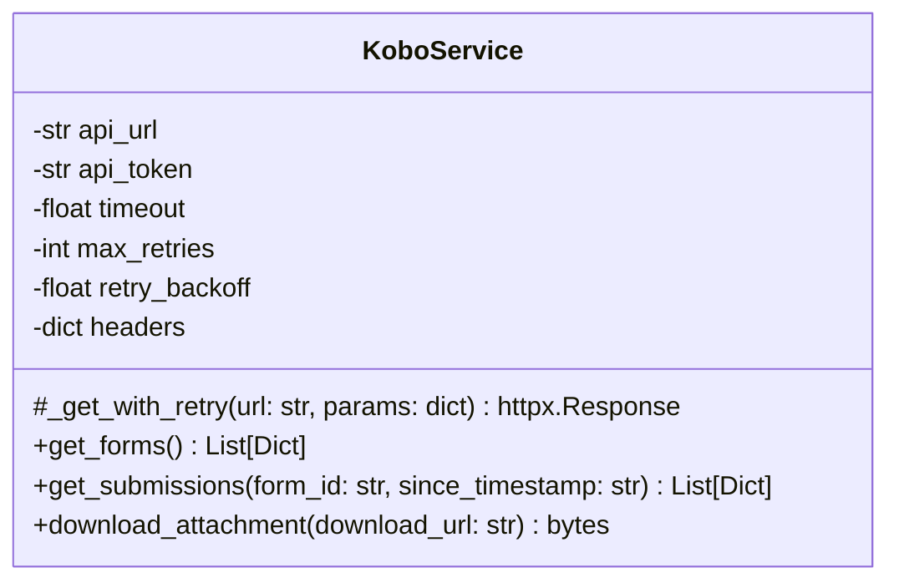

<!-- DIRTY_AMENDMENT: [Added kobo_asset_id column to form table and updated name-matching logic, approved by John 2026-06-09] -->
# Low-Level Design (LLD) — KoboToolbox API Integration

> **Stage 3 of 3 — Documentation Hierarchy**
> Owner: Winston (Architect) | Target Location: `docs/lld/kobotoolbox_integration_lld.md` | References: `docs/prd/kobotoolbox_integration_prd.md`
> Status: `Approved`

---

## 1. Authentication Protocol

KoboToolbox API v2 utilizes Token-based authentication. The client must present the credentials on every HTTP request inside the `Authorization` header:

```http
Authorization: Token YOUR_API_TOKEN
```

The credentials and configuration are loaded from environment variables (with safe module defaults for internal retry and cooldown policies):
- `KOBOTOOLBOX_API_URL` (e.g. `https://eu.kobotoolbox.org`)
- `KOBOTOOLBOX_API_TOKEN` (e.g. `your_api_token`; excluded from logs and error messages)
- `KOBOTOOLBOX_API_TIMEOUT` (default `60.0` seconds)
- `FRONTEND_URL` (default `http://localhost:3000`, used for alert CTA links)
- Internal policy defaults in `backend/app/services/kobo.py` (optional env overrides with safe fallback on empty/invalid values): `DEFAULT_MAX_RETRIES = 3`, `DEFAULT_RETRY_BACKOFF_SECONDS = 2.0`, `DEFAULT_CRASH_ALERT_COOLDOWN_SECONDS = 14400`

---

## 2. Component Design

`KoboService` in `backend/app/services/kobo.py` wraps HTTP client operations using `httpx` with bounded exponential backoff retries.



### 2.1 Interface & Methods

- **`_get_with_retry(url: str, params: dict | None = None) -> httpx.Response`**: Executes `client.get` with retries for `httpx.TimeoutException`, `httpx.TransportError`, and `httpx.HTTPStatusError` when `status_code` is in `{429, 500, 502, 503, 504}`. Non-retryable `4xx` responses (`400`, `401`, `403`, `404`) fail immediately.
  - Backoff honors numeric or HTTP-date `Retry-After` headers clamped to `[0.0, 60.0]` seconds. Without `Retry-After`, delay equals `min(60.0, retry_backoff * (2 ** attempt)) + random.uniform(0, 0.5 * base_delay)`.
- **`get_forms()`**: Fetches deployed assets/form structures via `_get_with_retry`.
  - Endpoint: `GET {KOBOTOOLBOX_API_URL}/api/v2/assets.json`
- **`get_submissions(form_id: str, since_timestamp: str | datetime | None = None)`**: Fetches responses submitted to a specific form via `_get_with_retry`.
  - Endpoint: `GET {KOBOTOOLBOX_API_URL}/api/v2/assets/{form_id}/data.json`
- **`download_attachment(download_url: str) -> bytes`**: Downloads media attachments via `_get_with_retry(download_url).content` before uploading to object storage.

---

## 3. Worker Integration & Alerting

The APScheduler daemon in `backend/app/scheduler.py` runs the background worker. `hourly_kobotoolbox_pull` invokes `sync_kobo_submissions(db)` to execute the sync:

1. Retrieve active form blueprints configured in the system database.
2. Initialize `KoboService`.
3. Fetch new submissions from KoboToolbox since the last successful sync timestamp.
4. Stage and ingest submissions into `datapoint` and `answer` tables, routing invalid records to `dead_letters`.

### 3.1 Crash Alert Cooldown, Recovery & Recipient Filtering

See `docs/features/009_kobo_sync_resilience_spec.md` for full specifications.

- **Human Admin Filtering**: `_get_human_admin_emails(db)` queries active users with `role == "admin"` (case-insensitive) and excludes `SYSTEM_USER_EMAIL` (`"system@nbd-wetland.org"`). Both DLQ warning emails and crash/recovery alerts use this filter; empty lists skip dispatch.
- **Crash Alert Cooldown**: On an unhandled crash, `_send_sync_crash_alert(db, error)` calls `db.rollback()`, reads the latest `AuditLog` row with `entity_type="kobo_sync"` and `action IN ("ALERT", "ALERT_RESOLVED")`, and suppresses duplicate alerts when an `"ALERT"` row falls within `KOBO_CRASH_ALERT_COOLDOWN_SECONDS` (default `14400`). Otherwise it sends `[CRITICAL ALERT]` via `EmailService.send_alert_email()` (resolving `action_url` from `FRONTEND_URL`) and inserts `AuditLog(actor_id=sys_user.id, action="ALERT", entity_type="kobo_sync", entity_id="ALERT_SENT")`.
- **Recovery Notification**: When a clean sync completes (`errors == []`) while the latest `kobo_sync` `AuditLog` row has `action == "ALERT"`, `_maybe_send_sync_recovery_alert(db)` sends a `[RECOVERY]` email (`alert_level="info"`) to human admins and inserts `AuditLog(actor_id=sys_user.id, action="ALERT_RESOLVED", entity_type="kobo_sync", entity_id="RESOLVED")`.
